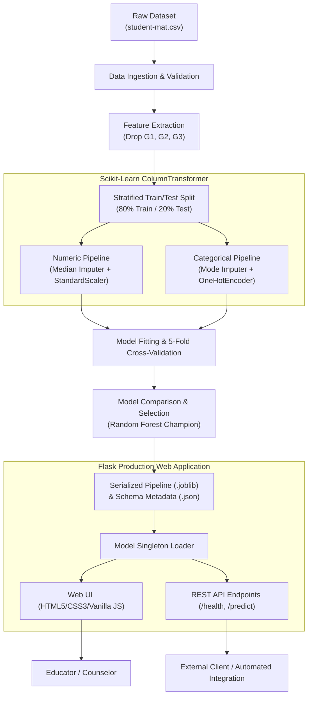

# Student Performance Prediction System
### Week 4 Capstone Project &bull; Machine Learning Internship

[](https://www.python.org/)
[](https://flask.palletsprojects.com/)
[](https://scikit-learn.org/)
[](https://pytest.org/)
[](LICENSE)

---

## 1. Project Title and Executive Overview

The **Student Performance Prediction System** is a complete, production-grade machine learning application developed during Week 4 of a 4-week Machine Learning internship. The system predicts secondary school students' final mathematics examination grades ($G3$, evaluated on a Portuguese standard 0–20 scale) utilizing 30 socio-demographic, familial, environmental, and academic behavior attributes.

Unlike conventional academic models that inadvertently rely on interim grade predictors ($G1$ and $G2$), this project strictly excludes past assessment scores to avoid data leakage. It relies solely on non-grade background features to deliver an early-warning decision support system for educators, counselors, and academic advisors.

---

## 2. Problem Statement and Objectives

### 2.1 Problem Statement
Educational institutions often struggle to identify students at risk of underperformance until midterm evaluations or final exams take place. By that time, remedial intervention opportunities are constrained. Predicting academic outcomes early—based on lifestyle, socio-economic factors, study routines, and support structures—enables proactive tutoring and guidance.

### 2.2 Objectives
1. **End-to-End Pipeline**: Implement a reproducible data preprocessing and model training pipeline using `scikit-learn`.
2. **Eliminate Data Leakage**: Exclude $G1$ (first period grade), $G2$ (second period grade), and $G3$ from input features.
3. **Model Evaluation & Selection**: Train, validate, and compare Linear Regression, Ridge Regression, and Random Forest Regression using 5-Fold Cross-Validation, MAE, RMSE, and $R^2$.
4. **Model Serialization**: Export the fitted preprocessing and estimator pipeline into a portable Joblib artifact with complete schema metadata.
5. **Interactive Web Application**: Build a modern, responsive Flask web application allowing teachers to simulate individual student profiles.
6. **RESTful Prediction API**: Implement validated JSON endpoints (`/health`, `/predict`, `/api/schema`) adhering to production API design principles.
7. **Comprehensive QA Testing**: Develop a full Pytest suite covering model loading, schema adherence, invalid inputs, edge cases, and non-retraining guarantees.
8. **Deployment Readiness**: Package the application with Gunicorn, `Procfile`, and Render cloud deployment configurations.

---

## 3. Dataset Description & Features

- **Source**: UCI Machine Learning Repository — *Student Performance Dataset* (`student-mat.csv`).
- **Delimiter**: Semicolon (`;`).
- **Records**: 395 students.
- **Target**: `G3` (Final academic year mathematics score, integer scale from 0 to 20; passing grade $\ge 10$).
- **Features Used**: Exactly 30 features (13 numerical, 17 categorical).

### 3.1 Feature Catalog

| Feature Group | Features | Description |
| :--- | :--- | :--- |
| **Academic & School** | `school`, `studytime`, `failures`, `schoolsup`, `famsup`, `paid`, `higher`, `absences` | School enrolled, study hours, past class failures, tutoring, aspiration for higher education, attendance. |
| **Demographics & Home**| `sex`, `age`, `address`, `famsize`, `Pstatus`, `guardian`, `traveltime`, `reason` | Gender, age (15–22), urban/rural address, family size, cohabitation status, commute time, school choice reason. |
| **Parental Background**| `Medu`, `Fedu`, `Mjob`, `Fjob` | Mother's and father's education levels (0–4) and occupations (teacher, healthcare, civil service, at home, other). |
| **Social & Lifestyle** | `internet`, `romantic`, `activities`, `nursery`, `famrel`, `freetime`, `goout`, `Dalc`, `Walc`, `health` | Internet access, romantic relationship, extracurriculars, family relationships (1–5), alcohol consumption, health status. |

---

## 4. System Architecture



---

## 5. Model Training and Measured Results

All models were evaluated using an 80/20 train/test split (`random_state=42`) alongside 5-Fold Cross-Validation.

### 5.1 Actual Measured Metrics

| Model | 5-Fold CV MAE | 5-Fold CV RMSE | 5-Fold CV $R^2$ | Train MAE | Train RMSE | Train $R^2$ | Test MAE | Test RMSE | Test $R^2$ |
| :--- | :---: | :---: | :---: | :---: | :---: | :---: | :---: | :---: | :---: |
| **Linear Regression** | 3.5227 | 4.6070 | -0.0924 | 2.9462 | 3.8651 | 0.2888 | 3.3953 | 4.1957 | 0.1415 |
| **Ridge Regression** | 3.5057 | 4.5839 | -0.0801 | 2.9461 | 3.8652 | 0.2887 | 3.3929 | 4.1934 | 0.1424 |
| **Random Forest (Champion)** | **2.9343** | **3.9419** | **0.2036** | **1.3372** | **1.8457** | **0.8378** | **3.0364** | **3.8126** | **0.2911** |

### 5.2 Key Findings
1. **Random Forest Superiority**: Random Forest achieved the lowest Test MAE (3.0364) and highest Test $R^2$ (0.2911), outperforming linear baselines.
2. **Top Predictive Features**: Feature importance analysis revealed that past class `failures`, `absences`, student `age`, `goout` (social outing frequency), and parental education (`Medu`, `Fedu`) are the strongest determinants of final achievement.
3. **Model Limitations**: Because previous examination scores ($G1, G2$) are intentionally omitted, an $R^2$ of ~0.29 reflects the intrinsic variability of student performance when predicted purely from non-grade survey factors.

---

## 6. Local Setup and Installation (Windows & Cross-Platform)

### 6.1 Prerequisites
- Python 3.10, 3.11, 3.12, 3.13, or 3.14 installed.
- Git installed.

### 6.2 Clone and Navigate
```powershell
git clone https://github.com/adithya222000666-arch/ml-internship-student-performance.git
cd ml-internship-student-performance
```

### 6.3 Set Up Virtual Environment
```powershell
# Create dedicated week4 virtual environment
python -m venv week4/.venv

# Activate on Windows PowerShell:
.\week4\.venv\Scripts\Activate.ps1

# (Or on Windows Command Prompt:)
# .\week4\.venv\Scripts\activate.bat

# (Or on macOS/Linux:)
# source week4/.venv/bin/activate
```

### 6.4 Install Dependencies
```powershell
python -m pip install --upgrade pip
python -m pip install -r week4/requirements.txt
```

---

## 7. Execution and Operation

### 7.1 Train the Model and Generate Outputs
```powershell
python week4/train_model.py
```
*Generated Artifacts:*
- `week4/models/student_performance_pipeline.joblib`: Serialized complete pipeline.
- `week4/models/model_metadata.json`: Feature definitions and validation boundaries.
- `week4/outputs/model_comparison.csv`: Tabular model evaluation.
- `week4/outputs/evaluation_summary.json`: Structured benchmark metrics.
- `week4/outputs/test_predictions.csv`: Actual vs predicted test scores.
- `week4/outputs/*.png`: 4 high-resolution diagnostic charts.

### 7.2 Run Automated Tests
```powershell
python -m pytest week4/tests -v
```
*All 16 unit, integration, and security edge-case tests pass.*

### 7.3 Start Local Web Application
```powershell
python week4/app.py
```
Open your web browser and navigate to:
```
http://127.0.0.1:5000/
```

---

## 8. Prediction API Documentation

### 8.1 Endpoint Overview

| Method | Endpoint | Description | Status Codes |
| :--- | :--- | :--- | :--- |
| `GET` | `/` | Web application graphical interface | `200` |
| `GET` | `/health` | Application status & model readiness | `200`, `503` |
| `GET` | `/api/schema`| Feature catalog & input constraints | `200` |
| `POST` | `/predict` | Predict student grade from JSON attributes | `200`, `400`, `503` |

### 8.2 Prediction Request Example (`POST /predict`)

```http
POST /predict HTTP/1.1
Host: 127.0.0.1:5000
Content-Type: application/json

{
  "school": "GP",
  "sex": "F",
  "age": 16,
  "address": "U",
  "famsize": "GT3",
  "Pstatus": "T",
  "Medu": 4,
  "Fedu": 4,
  "Mjob": "teacher",
  "Fjob": "health",
  "reason": "reputation",
  "guardian": "mother",
  "traveltime": 1,
  "studytime": 4,
  "failures": 0,
  "schoolsup": "no",
  "famsup": "yes",
  "paid": "no",
  "activities": "yes",
  "nursery": "yes",
  "higher": "yes",
  "internet": "yes",
  "romantic": "no",
  "famrel": 5,
  "freetime": 3,
  "goout": 2,
  "Dalc": 1,
  "Walc": 1,
  "health": 5,
  "absences": 2
}
```

### 8.3 Prediction Response Example

```json
{
  "status": "success",
  "predicted_g3": 13.05,
  "raw_prediction": 13.05,
  "scale": "0-20",
  "is_clipped": false,
  "academic_category": "Satisfactory",
  "standing_description": "Solid Passing Standing",
  "badge_class": "badge-satisfactory",
  "model_used": "Random Forest",
  "disclaimer": "This predicted grade is an automated statistical estimate generated by a machine learning model based on historical survey attributes. It does not guarantee student outcomes and should be used solely as a supplementary advisory indicator."
}
```

### 8.4 Error Responses
- **Missing Field** (`400 Bad Request`):
  `{"status": "error", "message": "Missing required feature(s): studytime"}`
- **Invalid Category** (`400 Bad Request`):
  `{"status": "error", "message": "Feature 'school' received invalid category 'HARVARD'."}`
- **Out of Range Numeric** (`400 Bad Request`):
  `{"status": "error", "message": "Feature 'age' value 99 is outside expected range [15, 22]."}`

---

## 9. Render Cloud Deployment Guide

The application is pre-configured for one-click or Git-connected deployment on [Render](https://render.com/) using Gunicorn WSGI.

### 9.1 Step-by-Step Render Deployment
1. **Push Changes to GitHub**: Verify all Week 4 files are pushed to `main`.
2. **Log in to Render**: Navigate to [https://dashboard.render.com/](https://dashboard.render.com/).
3. **Create Web Service**: Click **New +** &rarr; **Web Service** &rarr; **Build and deploy from a Git repository**.
4. **Connect Repository**: Select `adithya222000666-arch/ml-internship-student-performance`.
5. **Configure Service Settings**:
   - **Name**: `student-performance-system`
   - **Region**: Closest region (e.g., Singapore or Frankfurt).
   - **Branch**: `main`
   - **Root Directory**: `week4` *(Crucial: ensures Render builds from inside the week4 folder)*.
   - **Runtime**: `Python 3`
   - **Build Command**: `pip install -r requirements.txt`
   - **Start Command**: `gunicorn app:app --bind 0.0.0.0:$PORT`
   - **Instance Type**: `Free`
6. **Environment Variables**:
   - `PYTHON_VERSION`: `3.11.9`
7. **Deploy**: Click **Create Web Service**.
8. **Verify Deployment**:
   - Monitor build logs to confirm package installation and Gunicorn boot.
   - Visit `https://<YOUR-RENDER-SUBDOMAIN>.onrender.com/health` to confirm `{"status": "healthy"}`.
   - Test predictions directly via the live browser interface.

---

## 10. Screenshots and Visual Evidence

> *Instructions for Evaluator/Student*: Capture the following screenshots after launching or deploying:
> 1. **Home Page & Prediction Form**: Full view of the responsive form.
> 2. **Prediction Output**: Result card displaying the final grade gauge and performance category.
> 3. **Terminal Test Run**: Successful output of `pytest week4/tests -v`.
> 4. **Render Dashboard**: Service overview showing live status and deployment logs.

---

## 11. Ethical Considerations and Disclaimers

1. **Advisory Tool, Not an Automatic Gatekeeper**: Predictions must never be used to deny academic opportunities, streaming, or funding.
2. **Demographic Sensitivity**: Features such as parental occupation and residence type reflect historical correlations in a specific regional sample and should not be used to profile individual students.
3. **No Substitute for Human Compassion**: Automated algorithms cannot capture personal motivation, emotional resilience, or sudden life events.

---

## 12. Repository Information

- **GitHub Repository**: [https://github.com/adithya222000666-arch/ml-internship-student-performance](https://github.com/adithya222000666-arch/ml-internship-student-performance)
- **Live Deployed URL**: *(Fill with live Render URL once deployed, e.g. `https://student-performance-predictor.onrender.com`)*
- **Internship Student**: Adithya M.
- **Academic Degree**: B.Tech in Computer Science and Engineering
